Robert C martin created SOLID principals in 2000 after getting problems in a code/ Project
Problems are:
1. Maintainability
2. Readability
3. Bugs

SOLID:
S - Single responsiblity principle (SRP)
O - Open - close principle (OCP)
L - Liskov Substitution Principle (LSP)
I - Interface segregation principle (ISP)
D - Dependency inversion principle (DIP)

1. SRP (Single Responsibility principle)
-> A class should have onle one reason to change
-> A class should do only one thing

Real world ex: If only single Remote is gettin used for Tv, Ac or any other appliances then that remote must be having so much functinality and 
    because of that it will be very difficult to manage or fix if anything breaks

Ex:
    Problem: 
    if a ShoppingCart has so many products and the and class ShoppingCart has many methods like addProduct(); printInvoice(); saveToDB();
    then it breaks the SRP rule because it is handelling so many different responsibilites.
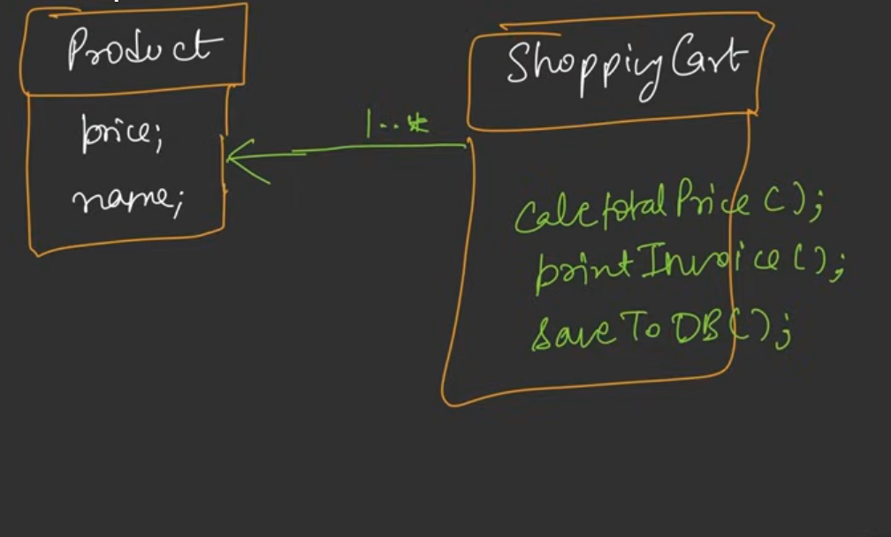

    Solution: (Composition)
    We can break down it to different classes and make those classes follow SRP (make them to do only one thing)
    like ShoppingCart with method addProduct();
         CartInvoicePrinter class with method printInvoice();
         CartDBStorage class with saveToDB();
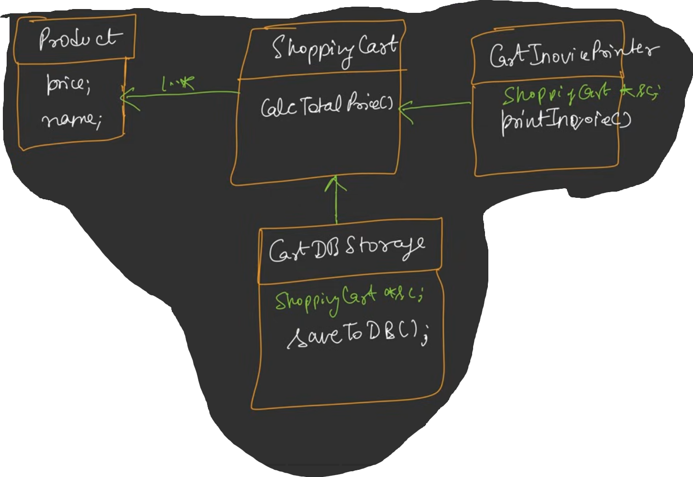

Path to code - SOLID\SRP\SRP.java

2. OCP (Open - Close Principle)
-> A class should be open for extension but close for modification

Ex:
    Problem:
    As we know from SRP we have created ShoppingCart, CartInvoicePrinter, CartDBStorage
    now let's assume CartDBStorage is getting new feature now - saveInMongoDB() and saveToFile(), we can directly write these new methods in CartDBStorage
    but this breaks OCP since we have modified the class
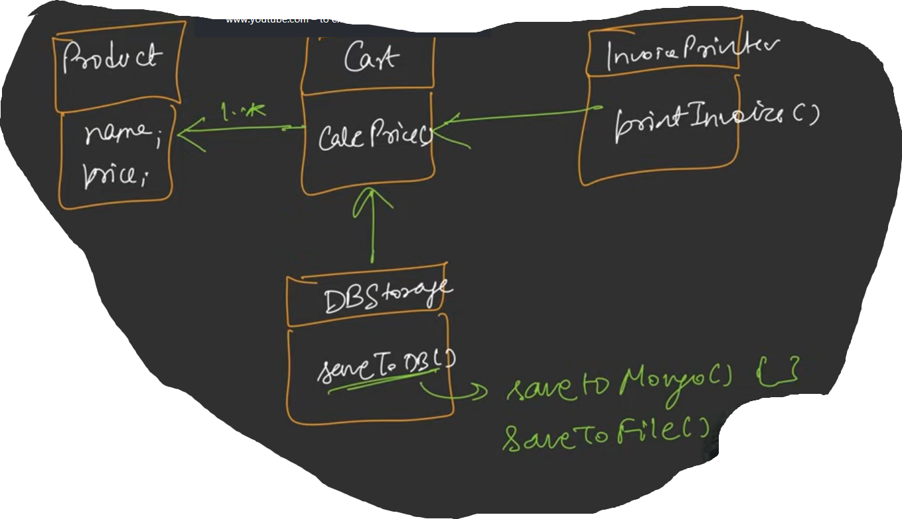

    Solution: (Abstraction, Inheritence, Polymorphism)
    We can make CartDBStorage (DBPersistent) as abstract/interface then we can create different classes for different file storage and all of them can 
    inherit/implement CartDBStorage which can have common saveToDB() method
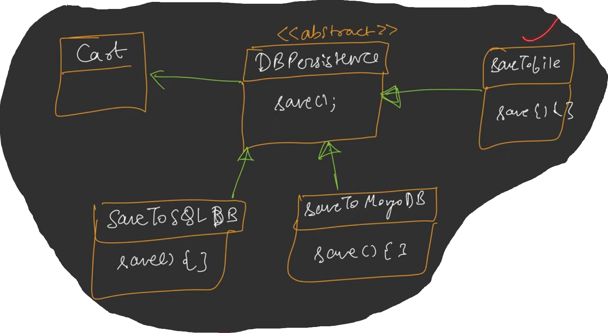

Path to code - SOLID\OCP\OCP.java

3. LSP (Liskov Substitution Principle)
-> Subclasses should be substitutable for their base classes.
-> If B is child of A then if any client is using A should be able to use B as well without changes, B should extend A, should not narrow it.
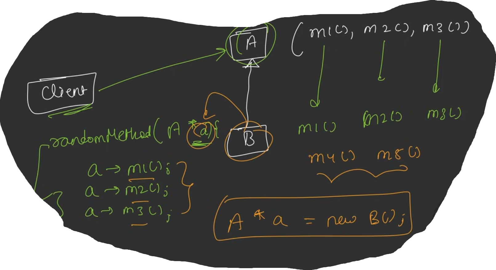

Ex:
    Problem:
    Let's assume we have Account abstract class where we have deposit() and withdraw(); where 2 childs SavingsAcc and CurrAcc extends it, it works fine
    but what if a new child FDAcc extends it, FDAcc should not have withdraw() feature, one way to override it is to modify the method to throw exception in FDAcc but that changes the behaviour of withdraw, if any client uses withdraw is might not be aware about exception, here the problem occurs because FDAcc narrows the feature of Account class.
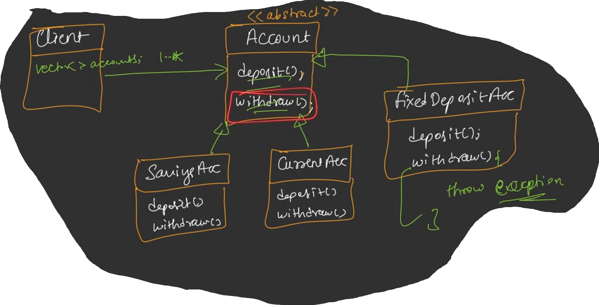

    Temp Solution: one solution could be to change in client and add condition for FDAcc and should not call withdraw for FDAcc but in this way client is getting tightly coupled with Account and if new methods comes again new conditions are needed in client, this is not a correct approach

    Solution:(composition)
    FDAcc should never be a child of Account because as per LSP Subclass should extend it not narrow, in that case we can make another interface DepositAccount with deposit() method and WithdrawAccount with withdraw() method, in this way we can resolve the issue and LSP will not break, now FDAcc can only implement DepositAccount and other classes can implement interfaces.
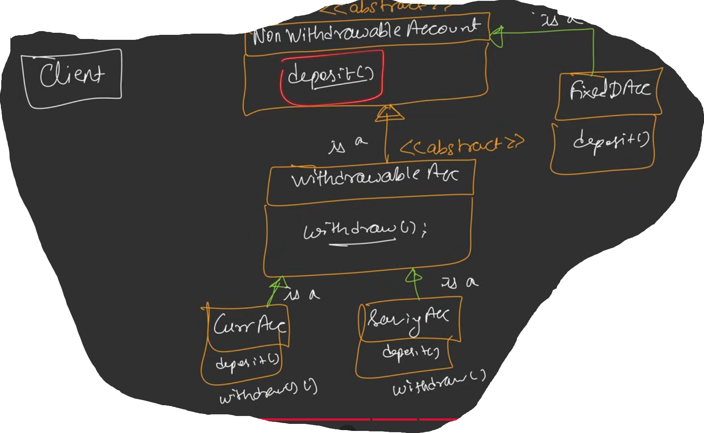

Path to code - SOLID\LSP\LSP.java

4. ISP (Interface Segregation Principle):
-> Many client specific interface are better then one general pupose interface.
-> client should not be forced to implement methods they don't need.

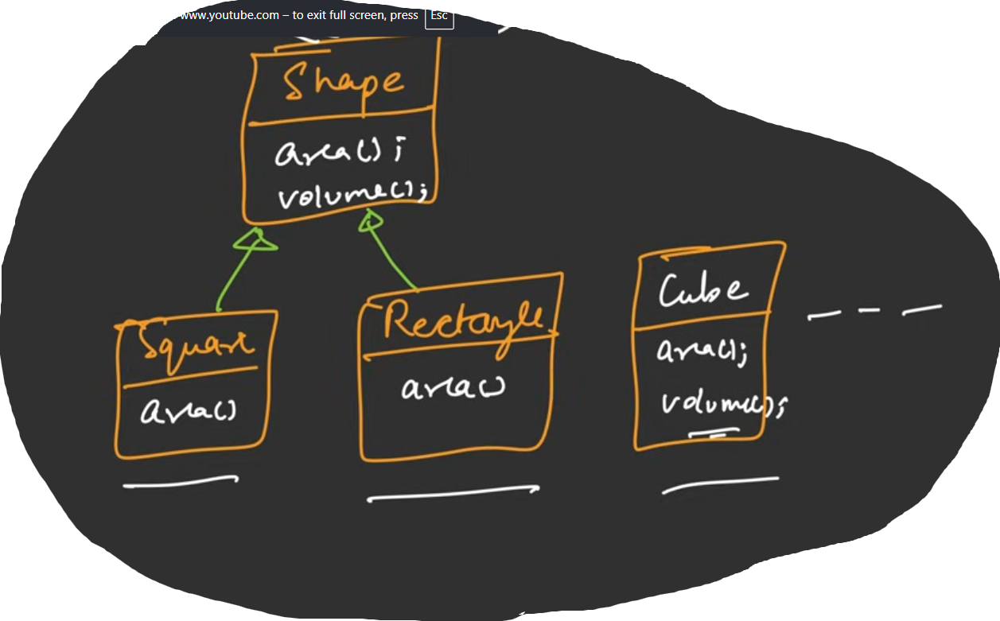

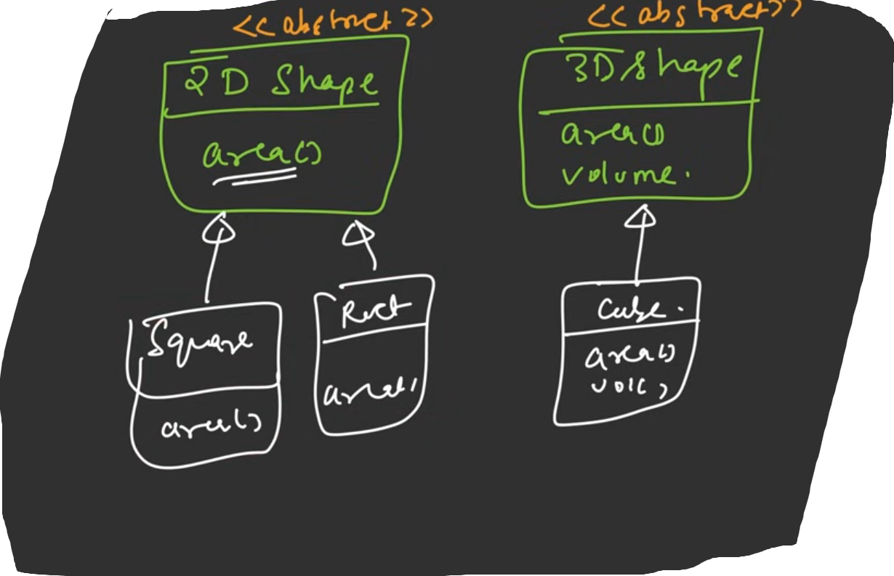

5. DIP (Dependency inversion principle):
-> High level module should not depend on low level module but rather both should depend on abstraction.

    Suppose we have an Application which interacts with DB, here Application is High level module and DB is low level module
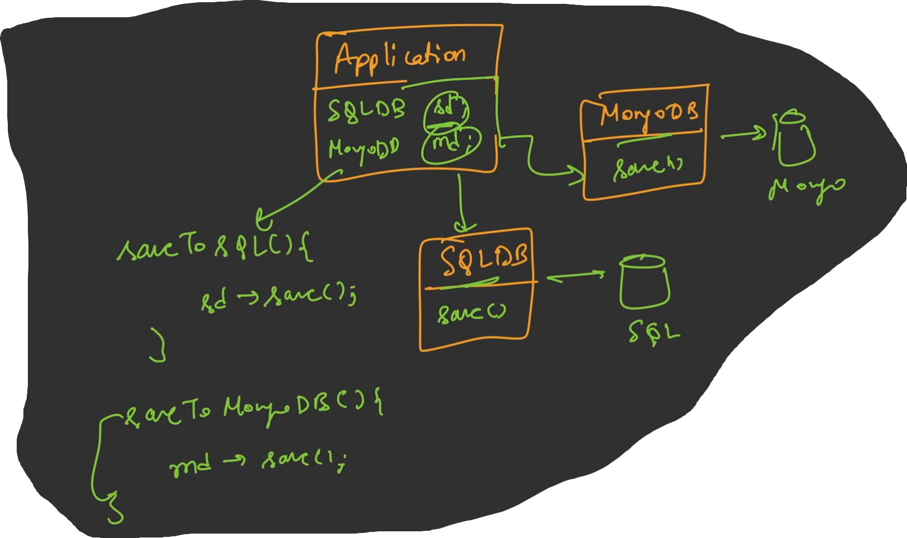

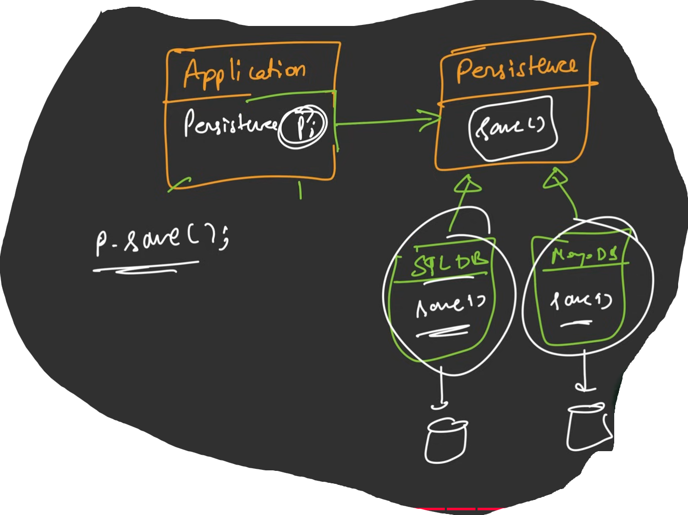